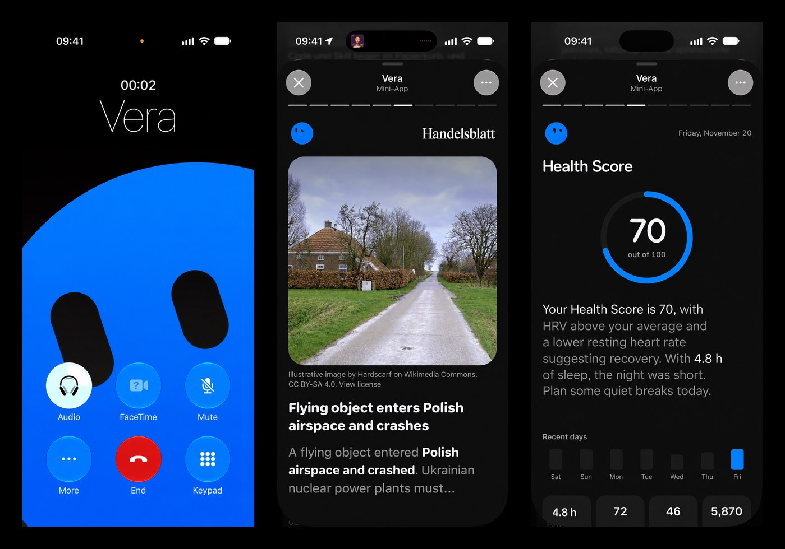

<h1>
  
  &nbsp;VeraKit
</h1>

VeraKit is an open-source kit for building your own personal AI assistant that runs on a server you control.

It grows out of Vera, the assistant I use every day. Vera lives in a single long-running conversation on a small home server, reaches me on Telegram, by phone and through a voice app, and quietly gets things done. When something matters, she calls. Before she pays for anything, sends a message to someone else, signs or deletes, she asks first with a simple yes or no.

> [!NOTE]
> VeraKit is in early development. The code is being extracted from Vera and will be published here. There is no release date yet. Star or watch this repository to follow along.

## What VeraKit is meant to be

- **Built on the accounts you already have.** VeraKit sits on top of one or more AI subscriptions such as Claude or ChatGPT instead of a new paid service.
- **Quiet by default.** It does the work and only reaches out with results, decisions or things that matter.
- **Four approvals.** Messages to others, payments, signatures and deletions always need your explicit yes.
- **Memory.** Facts, tasks, reminders and routines live in their own store, so the conversation stays lean.
- **Sources.** Mail, calendars, reminders, notes, messengers, your home and your network, connected through MCP tools.
- **Self-extending.** The assistant writes and improves its own tools, with backups, quota guards and a weekly self-check.

Running the assistant on your own server does not mean the AI models run locally. VeraKit talks to the model providers of the accounts you connect.

## Follow the build

- Website: [juliuspaetzke.studio/en/verakit](https://juliuspaetzke.studio/en/verakit/)
- Instagram: [@verakit.oss](https://www.instagram.com/verakit.oss/)
- X: [@verakit_oss](https://x.com/verakit_oss)

## Contributing

Not open for contributions yet. Ideas and questions are welcome as issues once the first code is published.

## License

The license will be added with the first code release.
